<div align="center">

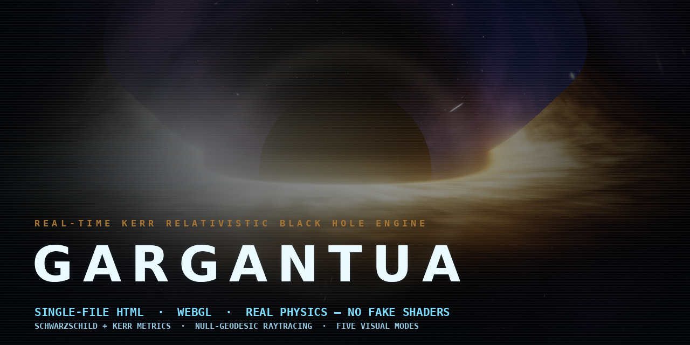

# GARGANTUA

**A real-time relativistic black hole engine, living inside one self-contained HTML file.**

**▶ [Play it now in your browser](https://borhanihesam10-beep.github.io/Gargantua-Web-Based-Graphics-Engine/)** — no install, no build, nothing to configure.

> ℹ️ **Performance note** — GARGANTUA runs like any modern 3D web app: it needs WebGL with hardware acceleration (on by default on normal desktops and laptops). Phones and older devices work too — just pick a lower quality tier in the engine's settings. See [`docs/WARNINGS.md`](docs/WARNINGS.md).

[](LICENSE)
[](CHANGELOG.md)
[](https://borhanihesam10-beep.github.io/Gargantua-Web-Based-Graphics-Engine/)
[](docs/PHYSICS.md)
[](#-quick-start)
[](#-quick-start)

`GARGANTUA` integrates **null geodesics through curved spacetime on your GPU**, every frame,
in pure GLSL — no engines, no frameworks, no build step, no network. Open one file and you are
in orbit around a 10⁸ M☉ Kerr black hole with a physically-computed accretion disk, gravitational
lensing, relativistic Doppler beaming, and a mission-grade flight deck.

**No fake physics. The frame-dragging term is the exact Kerr ZAMO angular velocity
ω = 2Mar / ((r²+a²)² − a²Δ·sin²θ) — evaluated per ray, per step.**

</div>

---

## 🌌 Why this one is different

Most "black hole" demos paint a glowing torus and call it a day. GARGANTUA computes the optics:

| Phenomenon | How GARGANTUA gets it |
|---|---|
| 🔭 **Gravitational lensing** | Light rays are numerically integrated through the field (Schwarzschild geodesic ODE, adaptive step size, RK2 sub-stepping near the hole) — the photon ring, the Einstein-ring disk fold-over and the shadow edge *emerge from the math*, nothing is drawn by hand. |
| 🌀 **Frame dragging (Kerr)** | Every ray is advanced in the locally-non-rotating frame using the exact ZAMO angular velocity ω(r,θ). At spin a = 0 the term collapses to a bit-exact no-op — the Schwarzschild baseline stays pristine. |
| 💫 **Relativistic Doppler beaming** | The approaching side of the disk is beamed and blue-shifted, the receding side dimmed — 1/(γ(1−β·n̂)) with the exact Kerr prograde orbital β. Full-physics modes push the g⁴ asymmetry; film modes damp it, like the movie did. |
| 🌡 **Accretion physics** | Disk temperature follows a Novikov–Thorne-style flux profile F ∝ (3/r)³·(1−√(r_isco/r)), blackbody-ramped, with the inner edge clamped to the **Bardeen prograde ISCO** — it genuinely shrinks as you increase the spin. |
| ⏱ **Time dilation** | The telemetry panel computes your ship clock rate √(1−rs/r) and one-way light time to the relay, live, from the camera state. |
| 🛰 **Computed telemetry, not painted numbers** | The MISSION deep-field scan derives shadow diameter (b = √27·M), prograde/retrograde photon-orbit radii, ISCO orbital velocity and the frame-dragging rate from the live Kerr model. |

**One file. 2.2 MB. Includes two embedded audio tracks.** Double-click it and the engine boots —
intro sequence, cinematic camera spline, full flight deck — even with the network cable pulled.

---

## 🎬 Five visual modes

Switch live with keys <kbd>5</kbd>–<kbd>9</kbd> or the deck buttons:

| Mode | Metric | Look & physics | Signature |
|---|---|---|---|
| 🎞 **CINEMATIC** | Schwarzschild, a = 0 | The protected baseline: exact untouched film look, grain, bloom — the reference render every other mode is measured against | `poster` view |
| 🪐 **INTERSTELLAR** | Kerr, a/M = 0.60 | The film's Gargantua: damped Doppler, creamy white grade, luminous halo, compact wide disk, auto-flies to the near-edge-on promo geometry | iconic ring |
| 🔬 **REALISTIC** | Kerr, full physics | Full computed beaming (g⁴), hot blue-shifted inner disk, razor-thin edge, neutral-cool instrument grade, near-zero static dither | asymmetric disk |
| 🛰 **MISSION** | Kerr + mission ops | The film look plus a NASA-style operations console: 5 survey objectives, deep-field geodesy scan, waypoints, mission log, Quindar-style beeps | live ops HUD |
| ⚡ **HYPERREAL** | Kerr, max fidelity | Everything turned up: widest disk extent (48 rs), hottest inner disk, strongest beaming exponent, cleanest grain — pair with the MAX quality tier | the ultimate render |

<details>
<summary><b>📸 Mode gallery (real captures — click to expand)</b></summary>

| | |
|---|---|
| 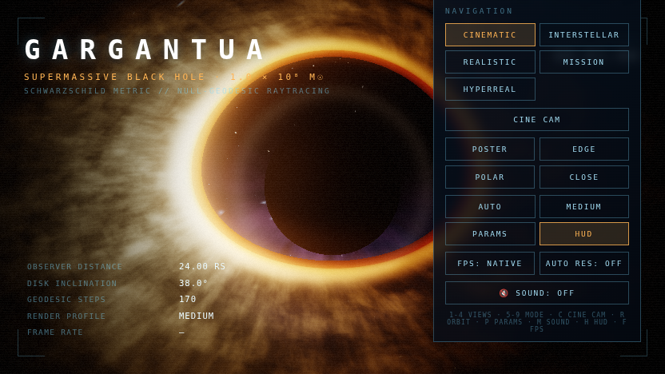<br><sub>🎬 CINEMATIC — poster view, protected a = 0 baseline</sub> | 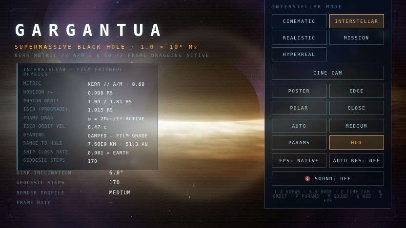<br><sub>🪐 INTERSTELLAR — a/M = 0.60, film-faithful grade</sub> |
| 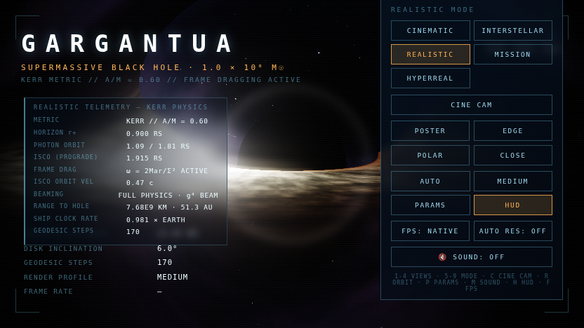<br><sub>🔬 REALISTIC — full g⁴ beaming, neutral instrument grade</sub> | 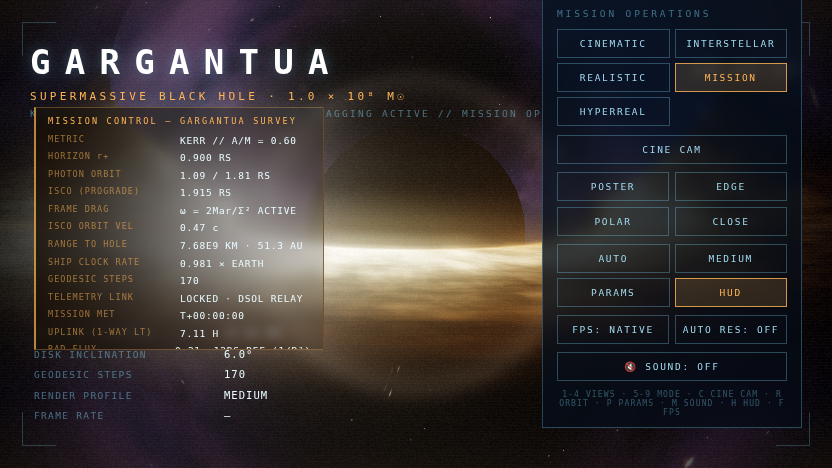<br><sub>🛰 MISSION — operations console, computed telemetry</sub> |
| 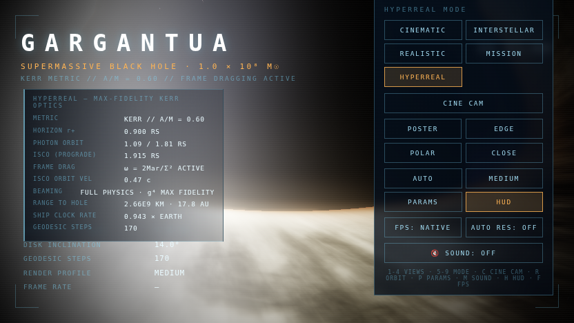<br><sub>⚡ HYPERREAL — max-fidelity Kerr optics</sub> | 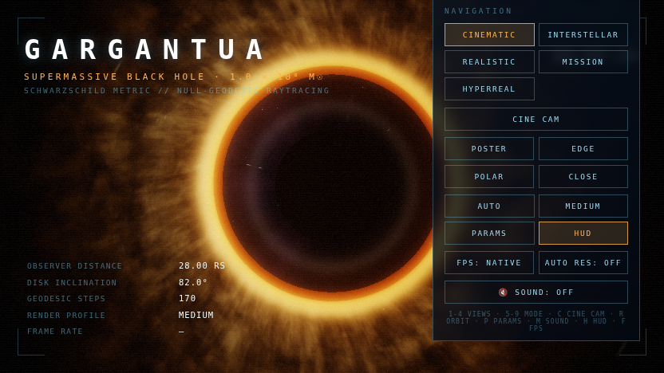<br><sub>🧊 Polar overflight — the disk lensed from above</sub> |
| 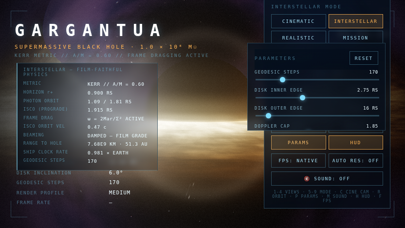<br><sub>⚙️ Parameters console — 23 live sliders over the render</sub> | 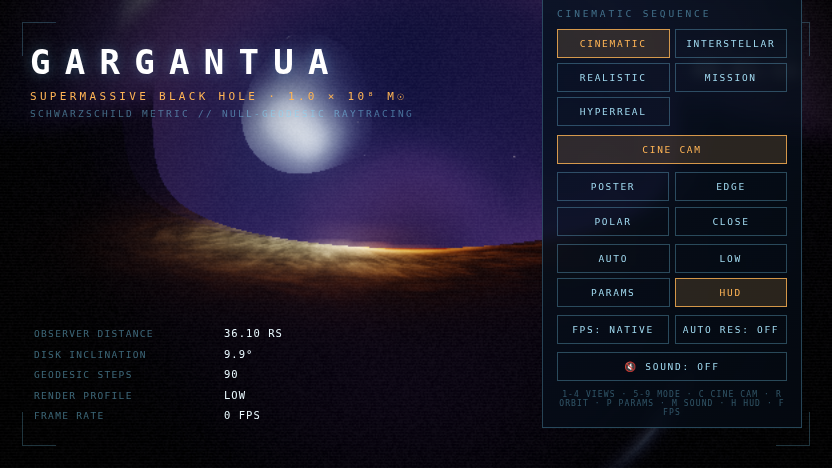<br><sub>🚀 Boot sequence — the intro title card</sub> |

</details>

---

## 🎞 It moves — real captures from the engine

| Orbital pass | Five-mode tour | Mission deep-field scan |
|---|---|---|
| 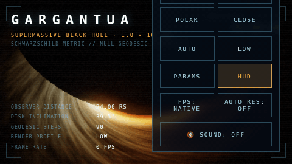 | 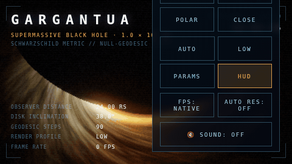 | 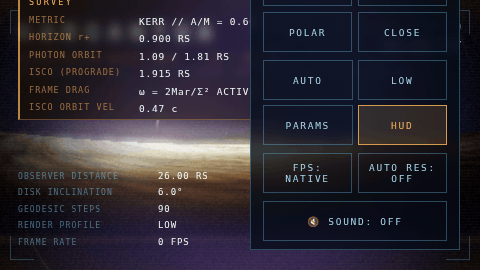 |

Every frame above was produced by the engine itself — the same geodesic kernel, bloom stack and
film grade you get when you open the file.

---

## 🚀 Quick start

**Option A — just open it** 🖱
Download `GARGANTUA.html` and double-click. That's the whole install.
Chrome / Edge / Firefox / Safari, desktop or mobile, online or offline.

**Option B — local server** (nicer URLs, identical behavior)

```bash
python3 -m http.server 8000
# → http://localhost:8000/GARGANTUA.html
```

**Option C — publish it** 🌍
Push this repo to GitHub and enable **Settings → Pages → Deploy from branch → main / (root)**.
Your engine goes live at `https://<username>.github.io/gargantua-engine/` — the full step-by-step,
including badges, topics and the social preview, is in [`docs/DEPLOY.md`](docs/DEPLOY.md).

> 💡 First visit? Press <kbd>C</kbd> for the cinematic camera sequence, <kbd>M</kbd> for sound,
> then hold and drag to fly the orbit yourself. The intro card fades after the first frame.

---

## 🕹 Controls at a glance

| Input | Action |
|---|---|
| 🖱 **Drag / arrow keys** | Orbit the hole |
| 🖱 **Wheel / pinch** | Dolly (safety floor at 4.5 rs — no station-keeping inside the photon sphere) |
| <kbd>1</kbd>–<kbd>4</kbd> | Camera presets: POSTER · EDGE · POLAR · CLOSE |
| <kbd>5</kbd>–<kbd>9</kbd> | Modes: CINEMATIC · INTERSTELLAR · REALISTIC · MISSION · HYPERREAL |
| <kbd>C</kbd> | Cinematic camera sequence (176 s looping spline) |
| <kbd>R</kbd> | Auto-orbit on/off |
| <kbd>P</kbd> | Parameters console |
| <kbd>S</kbd> | Deep-field scan (MISSION mode) |
| <kbd>M</kbd> / <kbd>H</kbd> / <kbd>F</kbd> | Sound · HUD · FPS target |

Full reference — every button, slider, preset and console row — lives in
**[`docs/CONTROLS.md`](docs/CONTROLS.md)**.

---

## ⚙️ Power-user surface

**23 live parameters** (geodesic steps, disk edges, Doppler cap, bloom, grain, FOV, Kerr spin…)
in the <kbd>P</kbd> console — persisted to `localStorage` between sessions, resettable in one click.

**URL parameters** for deterministic deep links:

```text
GARGANTUA.html?mode=interstellar&spin=0.6&q=high&nocine&cam=ist
```

| Param | Values | Effect |
|---|---|---|
| `mode` | `cin` `ist` `sci`/`real` `mis` `ultra`/`hyper` | Boot straight into a mode |
| `spin` | 0 … 0.9 | Kerr spin a/M override |
| `q` | `low` `medium` `high` `extra` `max` | Graphics tier |
| `cam` | `poster` `edge` `polar` `close` `ist` `mis` `mperi` `mpolar` `mrelay` | Exact camera pose |
| `steps` | 60 … 600 | Geodesic step budget |
| `debug` | 0–9 | Raw pipeline views (steps heatmap, disk crossings, radius bands…) |
| `nocine` / `ctime=` | — / seconds | Disable cinematic cam / start inside the loop |
| `shot` | — | Deterministic freeze-frame for automated QA |

**Built-in automation harness** 🧪 — `?shot` freezes after 4 frames, sets
`document.title = "SHOT_OK"` and exposes the whole engine state on `window.__G`.
Pixel-perfect regression testing of a WebGL renderer, with zero test framework.
Documented in [`docs/TECHNICAL_NOTES.md`](docs/TECHNICAL_NOTES.md).

---

## 📊 Performance tiers

Five manual tiers — the tier you pick is **never lowered behind your back**:

| Tier | Geodesic steps | Render-scale cap | Pixel budget | Best for |
|---|---|---|---|---|
| 🟢 LOW | 90 | 0.75× DPR | 0.9 MP | integrated GPUs, phones |
| 🟢 MEDIUM | 170 | 1.0× | 1.6 MP | laptops |
| 🟡 HIGH | 260 | 1.35× | 2.4 MP | discrete GPUs |
| 🟠 EXTRA | 380 | 1.7× | 3.2 MP | gaming rigs |
| 🔴 MAX | 520 | 2.2× | 4.8 MP | the flex zone |

Plus **FPS targets** (NATIVE / 120 / 60 — pacing only, never quality loss) and an
**opt-in** adaptive-resolution governor for sustained-32 fps rescue.
Tuning guide and troubleshooting: **[`docs/PERFORMANCE.md`](docs/PERFORMANCE.md)**.

---

## 📚 Documentation

| Doc | Contents |
|---|---|
| 🕹 [`docs/CONTROLS.md`](docs/CONTROLS.md) | Every input, preset, slider, HUD element and console row |
| 🧮 [`docs/PHYSICS.md`](docs/PHYSICS.md) | The geodesic integrator, Kerr formulas, disk model, post pipeline — with the actual math |
| ⚡ [`docs/PERFORMANCE.md`](docs/PERFORMANCE.md) | Tiers, budgets, governor logic, per-hardware tuning, troubleshooting |
| ℹ️ [`docs/WARNINGS.md`](docs/WARNINGS.md) | Requirements, per-device expectations and quality tuning tips |
| ❓ [`docs/FAQ.md`](docs/FAQ.md) | Black screens, sound policies, mobile behavior, settings storage, and more |
| 🌍 [`docs/DEPLOY.md`](docs/DEPLOY.md) | Push to GitHub, enable Pages, polish the repo presence |
| 🔬 [`docs/TECHNICAL_NOTES.md`](docs/TECHNICAL_NOTES.md) | Architecture map, engineering deep-dive, honest strengths/weaknesses, roadmap |
| 📜 [`CHANGELOG.md`](CHANGELOG.md) | V5.5 baseline → V12.1 HYPERREAL, feature by feature |

---

## 🧠 Physics at a glance

```
per ray, per step (GLSL):
  drag the ray into the ZAMO frame:   dφ = ω(r,θ)·dt,  ω = 2Mar / ((r²+a²)² − a²Δ·sin²θ)
  bend it:                            a⃗ = −(3/2)·h²·r̂ / r⁴        (h = |r⃗ × v̂|, rs = 1)
  disk sample:                        F ∝ (3/x)³(1−√(x_isco/x)),  T ∝ F^¼,  x_isco = Bardeen(a)
  relativistics:                      D = 1/(γ(1−β·n̂)),  g = √(1−rs/r)  →  I ∝ pow(D, g⁴-mix)·g·B(T·D·g)
then: 5-mip HDR bloom → temporal shutter → ACES → vignette → grain → chromatic aberration
```

The long version, including every approximation we *know* about, is in
[`docs/PHYSICS.md`](docs/PHYSICS.md) — because "trust me" is not a physics argument.

---

## 🛠 Under the hood

- **Raw WebGL 2 → WebGL 1 fallback** with a live half-float render-target probe (bloom auto-disables gracefully).
- **Hand-rolled UnrealBloom-style stack**: luminance high-pass → progressive separable Gaussian over 5 mips → additive composite — in ~80 lines of GLSL.
- **Verbatim three.js-style OrbitControls semantics** ported in-file (with exact-semantics math shims), so drag/pinch/pan feel exactly like the reference implementation — including the damped inertia and the pole-safe spherical reconstruction.
- **Anti-flicker engineering**: resize refill guard (no black flash on backing-store changes), DOM-diffed telemetry at 4 Hz, debounced resize, hysteresis-gated resolution governor, capped temporal shutter so the lensed ring can never smear to black.
- **Spacecraft-terminal UI**: hairline cyan/amber HUD, mission log, toasts, fatal-error card with recovery actions — all DOM, zero UI libraries.
- ♿ Accessibility touches: ARIA roles/labels, `:focus-visible`, and full `prefers-reduced-motion` paths.

---

## 🧭 Roadmap

See [`docs/TECHNICAL_NOTES.md`](docs/TECHNICAL_NOTES.md) for the full analysis. Highlights:

- [ ] CI golden-image regression harness built on the existing `?shot` hooks
- [ ] Optional module split + bundler output (single file stays the canonical artifact)
- [ ] WebGPU compute path for higher-order geodesics
- [ ] Starlight aberration & background redshift; disk vertical structure
- [ ] Shareable full-state URLs & settings import/export

## ⚠️ Known limitations

Honesty is a feature. The short list: the Kerr dragging term rotates the ray in the ZAMO frame
(exact ω-field, approximate transport — the a = 0 limit is exact); the disk is flat with a
volumetric halo approximation; Doppler is clamped per mode; both audio tracks ship inside the
HTML (2.2 MB total). Details in [`docs/TECHNICAL_NOTES.md`](docs/TECHNICAL_NOTES.md).

---

## 🤝 Contributing

Issues and PRs welcome — start with [`CONTRIBUTING.md`](CONTRIBUTING.md)
(no build step required, the QA hooks make verification easy).

## 📜 License

[MIT](LICENSE) — fly it, fork it, ship it.

## 🙏 Credits & references

- Inspired by the double-negative/DNGR black hole of *Interstellar* (Nolan / Thorne) and by every
  real-time geodesic tracer that came before.
- Physics: Bardeen, Press & Teukolsky (1972) — Kerr orbits; Page & Thorne (1974) — thin-disk flux;
  James, von Tunzelmann, Franklin & Thorne (2015) — *DNGR* rendering.
- Built with vanilla JavaScript and raw GLSL. No frameworks were harmed.

<div align="center">
<sub>⚡ If this engine bends your sense of what one HTML file can do, a star keeps the singularity stable. ⚡</sub>
</div>
